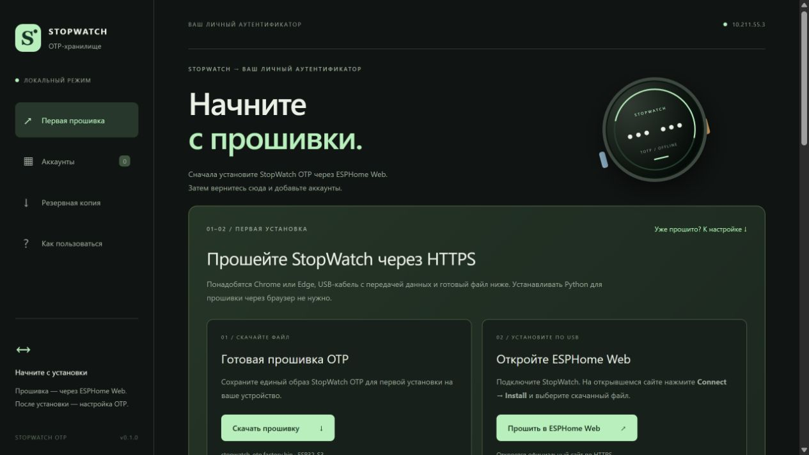
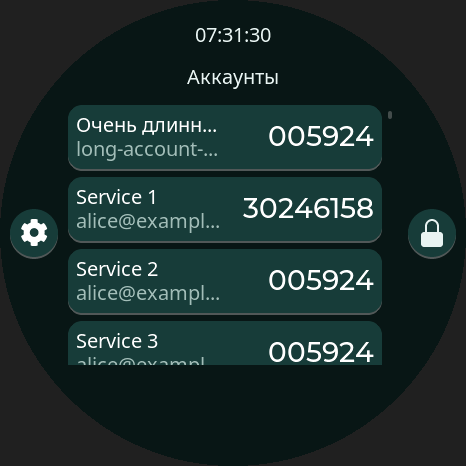
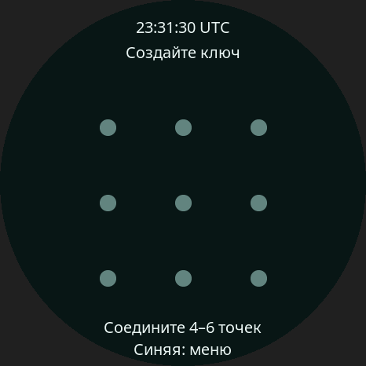
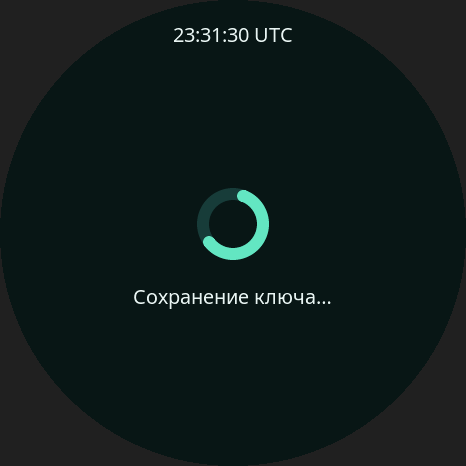

# StopWatch OTP

Автономное TOTP-хранилище для **M5Stack StopWatch C152** и локальный сайт настройки через USB.

Возможности: 100 аккаунтов, SHA-1/SHA-256/SHA-512, 6/8 цифр, период 30/60 секунд, графический ключ из 4–6 точек на сетке 3×3, подтверждение операций на устройстве, зашифрованные переносимые копии `.otpvault`.

Сайт работает на Windows в **Chrome или Edge** по адресу `http://127.0.0.1:8765/`. Wi-Fi на устройстве не запускается. Bluetooth-клавиатура включается отдельно в настройках StopWatch и вводит одноразовый код в активное поле компьютера. Все файлы сайта, включая распознавание QR, находятся в проекте. Интернет требуется для первоначальной установки инструментов и загрузки зависимостей сборки.

Главная страница начинает с первой установки: **скачать единый файл → открыть https://web.esphome.io/ → Connect → Install → выбрать файл**. После установки вернитесь к разделу настройки аккаунтов. Для прошивки через ESPHome Web установка Python или ESP-IDF на Mac/ПК с браузером не нужна; требуется интернет для открытия официального прошивальщика.



## Статус

Исходники, локальный сайт, скрипты сборки и автоматические проверки включены в проект. Результаты проверки находятся в [docs/VALIDATION.md](docs/VALIDATION.md). Прошивка и инструкция не являются подтверждением испытаний физического устройства: экран, USB, RTC и энергопотребление нужно проверить на вашем StopWatch по [аппаратному сценарию](docs/HARDWARE-TESTS.md).

## 1. Подготовка Windows

1. Установите [ESP-IDF 5.5.4](https://docs.espressif.com/projects/esp-idf/en/v5.5.4/esp32s3/get-started/windows-setup.html) с инструментами **ESP32-S3**, Git и Python.
2. Откройте **ESP-IDF PowerShell**, а затем папку проекта. Обычный PowerShell без активированного ESP-IDF для сборки не подходит.
3. Подключите StopWatch кабелем USB-C **с передачей данных**. Запишите COM-порт из диспетчера устройств. При переходе между прошивкой и рабочим USB-режимом номер порта может меняться.
4. Для входа в режим загрузки удерживайте кнопку питания около двух секунд до зелёного индикатора, как описано в [документации M5Stack](https://docs.m5stack.com/en/core/StopWatch).

## 2. Собрать и установить прошивку

В активированном ESP-IDF PowerShell:

```powershell
Set-Location 'C:\Mac\Home\Documents\M5Stack StopWatch'
python tools/build.py
```

Скрипт проверяет закреплённые коммиты M5GFX, M5PM1, M5IOE1 и LVGL. При отсутствии компонентов он загружает их. Сборка выполняется в коротком локальном пути `%USERPROFILE%\.sotp`, что позволяет работать из общей папки Mac/Windows, из пути с пробелами и обойти ограничения длины путей GCC. Готовые образы копируются в `dist\firmware`.

Первая прошивка, где `COM7` нужно заменить вашим портом:

```powershell
python tools/build.py --flash --port COM7
```

Если пользуетесь подготовленным комплектом с файлами в `dist\firmware`, повторная сборка не нужна. В ESP-IDF PowerShell проверьте контрольные суммы и прошейте готовые образы:

```powershell
python tools/flash.py --verify-only
python tools/flash.py --port COM7
```

Скрипт не стирает всю Flash и не программирует eFuse. Secure Boot, аппаратное шифрование Flash и NVS HMAC отключены. Если ранее стояла другая прошивка, её данные в новых разделах могут быть распознаны как повреждённое хранилище: на StopWatch выберите **«Сбросить»** и подтвердите удаление. При наличии нужных данных прежней прошивки сначала сохраните их отдельно.

## 3. Первый запуск

### Первая прошивка из браузера на Mac или Windows

Python и ESP-IDF на компьютере с браузером для этого варианта не нужны.

1. Скачайте `stopwatch-otp.factory.bin` с нашего сайта: `/download/stopwatch-otp.factory.bin`. Это объединённые загрузчик, таблица разделов и приложение для записи с адреса **0x0**. Обычный `stopwatch_otp.bin` для этого варианта не подходит.
2. Откройте **https://web.esphome.io/** в Chrome или Edge. Подключите StopWatch USB-кабелем с передачей данных, при необходимости переведите его в режим загрузки по разделу 1.
3. Нажмите **Connect**, выберите порт StopWatch. Затем **Install**, выберите `stopwatch-otp.factory.bin` и начните установку. Не выбирайте установку стандартной ESPHome-прошивки / Prepare for first use.
4. Дождитесь завершения и перезапустите устройство. Это наша прошивка OTP, ESPHome используется только как загрузчик.

**В Parallels:** если Chrome открыт в macOS, передайте USB-устройство Mac; если Chrome в Windows — Windows. Один USB-порт не может одновременно использоваться обеими системами. Для установки не требуется передавать браузеру графический ключ или секреты аккаунтов.

**Только первая установка:** объединённый файл включает заполнение промежутков, в том числе NVS. Для обновления существующего хранилища сначала создайте резервную копию и используйте `python tools/flash.py --update --port COM7`, как описано далее. Аппаратная установка через браузер пока не проверена на физическом StopWatch.

Образ создаётся из проверенных файлов командой `python tools/make-browser-image.py` в Python-среде с esptool 4.12.0. Параметры: ESP32-S3, DIO, 80 MHz, Flash 16 MB. eFuse не программируются.

### Создание графического ключа и настройка

1. На сетке **3×3** соедините **4–6 разных точек одним движением**, отпустите палец и повторите рисунок. Промежуточная точка между крайними добавляется автоматически, повторно выбранные точки игнорируются. Ключ проверяется после отпускания пальца; дождитесь завершения обработки.
2. Запустите `start-web.cmd`. Он находит Python из установленного ESP-IDF и открывает локальный сайт. Если браузер по умолчанию другой, скопируйте адрес в Chrome или Edge.
3. Нажмите **«Подключить»**, выберите рабочий USB-порт StopWatch.
4. На устройстве нажмите **«Разрешить USB»** в списке аккаунтов, если время ещё не установлено или аккаунтов нет. Эта же кнопка всегда доступна в **«Настройках»**. Разрешение нужно включать после подключения браузера: новый USB-сеанс сбрасывает прежнее разрешение.
5. Проверьте часы и часовой пояс компьютера. На сайте нажмите **«Установить время»**, проверьте предложенные местные дату, время и смещение UTC на устройстве и подтвердите.

В **«Настройки» → «Сменить ключ»** можно дважды задать новый рисунок. При отмене действующий ключ сохраняется. Рисунок короче четырёх точек или седьмая новая точка отклоняются целиком.

Проверка рисунка выполняет PBKDF2-HMAC-SHA256 с 600 000 итераций, поэтому на ESP32-S3 может занимать несколько секунд. Во время проверки или сохранения ключа вращается кольцо; дождитесь завершения. Прошивка обновляет анимацию между порциями вычислений и повторно использует промежуточные состояния HMAC внутри одной проверки. После проверки промежуточные состояния стираются. Фактическую длительность нужно измерить на StopWatch; результат теста на ПК не определяет время на устройстве.

Локальный сервер обслуживает только файлы сайта и не принимает секреты через HTTP. Для его остановки закройте окно сервера или нажмите Ctrl+C. Одновременно портом может пользоваться только один клиент: закройте Serial Monitor перед подключением сайта.

### Python: добавить аккаунты без сайта

Скрипт `tools/otp_cli.py` работает с прошивкой по USB и не требует браузера, HTTP или HTTPS. Поддерживает `ports`, `status`, `add`, `import`, `list`, `time` и `lock`. Графический ключ вводится только на StopWatch. Для `import` требуется обновлённая прошивка: весь набор подтверждается один раз. Одиночное добавление и установка времени также требуют подтверждения на устройстве.

**Windows / Parallels:** закройте соединение ESPHome Web/сайта и Serial Monitor. Передайте USB в Windows. В PowerShell из папки проекта:

```powershell
.\otp-usb.cmd ports
.\otp-usb.cmd --port COM4 status
.\otp-usb.cmd --port COM4 add
```

Замените `COM4` портом из первой команды. Ярлык `otp-usb.cmd` автоматически использует Python установленного ESP-IDF, где pySerial уже есть. Если используете собственный Python, установите зависимость: `python -m pip install -r tools/requirements-usb.txt` и запускайте `python tools/otp_cli.py ...`.

**Mac:** USB должен принадлежать macOS, а не Windows в Parallels. Из папки проекта, с Python 3.9 или новее:

```sh
python3 -m venv .venv
source .venv/bin/activate
python3 -m pip install -r tools/requirements-usb.txt
python3 tools/otp_cli.py ports
python3 tools/otp_cli.py --port /dev/cu.usbmodemXXXX add
```

Укажите настоящий путь из `ports`. Для `add` вставьте ссылку `otpauth://totp/...` либо секрет Base32 в **скрытое поле ввода**. При Base32 скрипт спросит сервис и аккаунт; при ссылке возьмёт параметры из неё. Для ручного выбора параметров используйте `add --algorithm SHA256 --digits 8 --period 60`. Секрет и ссылку не передавайте аргументами командной строки.

После запуска скрипт открывает порт и ждёт до двух минут: **разблокируйте устройство и включите «Настройки» → «Разрешить USB» на StopWatch именно после открытия порта**. Затем подтвердите сохранение аккаунта на его экране. Не закрывайте и не открывайте порт между этими шагами; после закрытия USB-разрешение сбрасывается. Если первые сообщения потерялись при подключении, скрипт повторяет только чтение статуса, но никогда автоматически не повторяет изменение данных.

Список и установка времени (время ПК должно быть верным):

```powershell
.\otp-usb.cmd --port COM4 list
.\otp-usb.cmd --port COM4 time
```

Каждый запуск требует нового физического разрешения USB. В списке USB-клиента нет секретов и кодов. При `time` подтвердите местное время и смещение часового пояса компьютера на StopWatch — без достоверного времени коды не показываются.

Неверное или неустановленное время **не блокирует USB и добавление аккаунтов**. Редактора даты и времени на самом StopWatch нет: часы устанавливаются с компьютера командой `time` или кнопкой сайта, после подтверждения на устройстве.

**Несколько аккаунтов:** `python3 tools/otp_cli.py --port /dev/cu.usbmodemXXXX import private/accounts.json` (Windows: `.\otp-usb.cmd --port COM4 import private\accounts.json`). Файл содержит массив записей из раздела «Запись аккаунта» в `docs/PROTOCOL.md` либо объект `{"records":[...]}`. `id` можно опустить для новых записей; алгоритм, цифры и период по умолчанию SHA1/6/30. Существующая запись с тем же UUID заменяется после подтверждения, остальные аккаунты сохраняются.

Весь файл и доступное место проверяются до первого изменения. Записи сначала передаются в память устройства, затем StopWatch показывает количество добавлений, замен и итоговый размер хранилища. **Одно подтверждение сохраняет весь набор одной операцией**, остальные аккаунты сохраняются. Отмена или обрыв до подтверждения оставляют прежнее хранилище; если потерян ответ на сохранение, перечитайте список перед повтором. Автоматических повторов записи нет. Для повторного импорта сохраняйте UUID в исходном файле; без UUID повторный запуск создаст новые записи. Зашифрованные `.otpvault` этот скрипт не расшифровывает. JSON содержит открытые секреты: держите его в исключённой из Git папке `private/`. Скрипт не создаёт файлов с секретами и не выводит их; Python не гарантирует полное стирание копий строк из памяти. После добавления обновите резервную копию.

### Запуск сайта в локальной сети

На ПК, который раздаёт сайт, запустите `start-web-lan.cmd` вместо `start-web.cmd` (сначала остановите прежний сервер). Сервер слушает TCP 8765 на всех IPv4-интерфейсах и печатает сетевые адреса. На втором ПК откройте `http://IP-ПЕРВОГО-ПК:8765/`. В разделе «Как пользоваться» доступен ZIP-комплект с прошивкой и инструкцией. Сервер раздаёт только сайт и этот ZIP; исходная папка проекта и файлы хранилища через HTTP не доступны.

Если Windows блокирует входящие подключения, выполните `powershell -ExecutionPolicy Bypass -File .\tools\allow-lan.ps1` из PowerShell **от имени администратора**. Правило открывает только TCP 8765 для локальной подсети. Не настраивайте проброс порта из интернета.

**Parallels:** адрес вида `10.211.55.3` в режиме Shared Network обычно доступен только хосту Mac и его виртуальным машинам. Для подключения других физических ПК переключите сеть виртуальной машины в **Bridged Network** на активный Wi-Fi/Ethernet, перезапустите сервер и используйте новый адрес из домашней сети. Другой вариант — запустить сервер прямо на Mac из общей папки проекта: `python3 tools/server.py --host 0.0.0.0` (нужен Python 3); готовая команда находится в `start-web-lan-mac.command`. Используйте IP Mac из настроек сети.

**USB и прошивка на втором ПК:** эта страница управляет уже прошитым StopWatch, встроенного веб-прошивальщика в ней нет. Обычный сетевой HTTP не разрешает Web Serial и Web Crypto. Скачайте ZIP, распакуйте его на втором ПК, установите ESP-IDF/Python по разделу 1 и прошейте устройство по разделу 2. Для готовых образов полная среда сборки не нужна: достаточно Python 3 и `python -m pip install esptool==4.12.0`, затем `python tools/flash.py --port COM7` с вашим портом. После прошивки запустите `start-web.cmd` на втором ПК и откройте **http://127.0.0.1:8765/** в Chrome или Edge. StopWatch должен быть подключён USB именно к этому ПК.

### Собственный HTTPS-сайт в Parallels, браузер на Mac

Сервер поддерживает TLS через `--cert` и `--key`. Сертификат должен быть доверенным для macOS и содержать IP/имя сервера в Subject Alternative Name. Простого обхода предупреждения браузера о сертификате недостаточно.

Для локальной сети можно использовать [mkcert](https://github.com/FiloSottile/mkcert). На **Mac** установите mkcert из официального источника, затем выполните из папки проекта (замените `10.211.55.3`, если адрес Windows изменился):

```sh
mkcert -install
mkdir -p .cache/tls
mkcert -cert-file .cache/tls/site.pem -key-file .cache/tls/site-key.pem 10.211.55.3 localhost 127.0.0.1
```

`mkcert -install` потребует системное подтверждение macOS: он устанавливает локальный центр сертификации. Его закрытый ключ `rootCA-key.pem` никому не передавайте. Файлы сертификата и ключа сервера остаются в игнорируемой `.cache/tls`, в комплект выпуска не включаются.

В **Windows Parallels** из общей папки проекта запустите отдельный HTTPS-сервер (порт 8767 не мешает работающему HTTP на 8765):

```powershell
python tools/server.py --host 0.0.0.0 --port 8767 --cert .cache/tls/site.pem --key .cache/tls/site-key.pem --no-browser
```

На Mac откройте **https://10.211.55.3:8767/** в Chrome/Edge. Если Windows блокирует новый порт, разрешите входящий TCP 8767 из локальной подсети в брандмауэре. Устанавливать доверие к сертификату в Windows для браузера на Mac не требуется. Этот вариант пока не настроен автоматически: сертификат нужно выпустить и доверить на вашем Mac. Для первой прошивки без настройки сертификатов используйте ESPHome Web, описанный выше.

## 4. Добавить аккаунт

1. В настройках безопасности сервиса начните подключение аутентификатора TOTP.
2. На локальном сайте нажмите **«Добавить аккаунт»**. Выберите один способ: QR-картинка PNG/JPEG/WebP, ссылка `otpauth://totp/...`, либо ручной ввод сервиса, аккаунта и секрета Base32.
3. Нажмите **«Добавить»** и проверьте данные на экране StopWatch. Подтвердите сохранение.
4. Откройте аккаунт на устройстве. Полученным кодом завершите настройку 2FA в сервисе.
5. Сохраните новую резервную копию.

Стандартные QR-коды TOTP и экспорт Google Authenticator (`otpauth-migration://`, версии 1 и 2, а также экспорт без поля версии / с версией 0) поддерживаются. HOTP, Steam и нестандартные длины/периоды кодов не поддерживаются. Названия ограничены 96 байтами UTF-8 для сервиса и 128 для аккаунта; секрет — 10–128 байтами.

Для переименования используйте **«Изменить»** в списке сайта. Для изменения секрета удалите прежнюю запись и добавьте новую. Удаление требует подтверждения на StopWatch.

### Перенести из Google Authenticator — один аккаунт или все

Для переноса всей группы с одним подтверждением обновите сайт и прошивку StopWatch. Если аккаунты уже есть на устройстве, используйте обновление приложения с `--update` по разделу 8: оно сохраняет хранилище и графический ключ. Старая прошивка определяется до передачи аккаунтов; сайт предложит её обновить.

1. Перезапустите локальный сервер и откройте **http://127.0.0.1:8765/** в Chrome или Edge на компьютере с подключённым StopWatch. Подключитесь к USB, разблокируйте устройство и разрешите USB в его настройках.
2. На телефоне откройте Google Authenticator → **Перенос аккаунтов → Экспорт аккаунтов**, подтвердите доступ и выберите один, несколько или все аккаунты.
3. На сайте нажмите **«Из Google Authenticator» → «Сканировать камерой»**, разрешите камеру и покажите ей QR на экране телефона. Можно также выбрать фото/картинки QR или вставить уже считанную ссылку переноса в раскрывающемся поле.
4. Если Google показывает несколько QR, прочитайте **каждый QR этого экспорта**. Сайт покажет, сколько прочитано. Повтор одного QR не создаёт дубликаты; смешивать QR разных экспортов нельзя.
5. Отметьте нужные аккаунты и нажмите **«Перенести выбранные»**. Дождитесь передачи и **один раз подтвердите весь набор на StopWatch**. Лимит — 100 аккаунтов вместе с существующими; совпадающие сервис и имя пропускаются без замены.
6. При необходимости нажмите **«Установить время»** и подтвердите часы на устройстве. Сравните коды с Google Authenticator, затем создайте резервную копию `.otpvault`.

QR распознаётся локальной библиотекой, секреты находятся в памяти браузера и передаются устройству по USB. Изображения и ссылки не отправляются серверу и не сохраняются сайтом. Камера останавливается после чтения всех QR, при закрытии окна или начале переноса. Фото QR содержит секретные ключи — не публикуйте его и не загружайте в онлайн-конвертеры.

Формат Google не содержит периода; импорт использует **30 секунд**. Если поля алгоритма, числа цифр или типа OTP отсутствуют / имеют значение UNSPECIFIED, используются стандартные **SHA1, 6 цифр, TOTP**. Неподдерживаемые записи (например, явно указанный HOTP) отклоняют весь соответствующий QR до отправки данных устройству. До общего подтверждения хранилище не меняется. При сбое записи сохраняется старый или новый полный набор, без частичного импорта. Сайт не повторяет запись автоматически; после потери ответа на сохранение проверьте список на StopWatch перед новым импортом.

## 5. Пользоваться без компьютера

- Нарисуйте графический ключ. В списке имя и email находятся слева, текущий код — справа. Коснитесь карточки, чтобы открыть крупный код и оставшиеся секунды. При подключённой Bluetooth-клавиатуре это также один раз вводит код на компьютере. Касание крупного кода повторяет ввод. Длинные названия сокращаются многоточием; код всегда виден целиком.
- Круглая кнопка с шестерёнкой слева по середине экрана открывает настройки; кнопка с замком справа блокирует устройство.
- Верхние часы показывают местное время компьютера, часовой пояс которого сохранён при последней синхронизации. После переезда или сезонного перевода часов повторите **«Установить время»**. До первой передачи часового пояса часы подписаны UTC; при недостоверном RTC отображается `--:--:--`, коды скрыты. Внутри RTC и расчёт TOTP используют UTC.
- **Жёлтая кнопка:** следующий аккаунт, без отправки кода на компьютер.
- **Синяя кнопка:** список аккаунтов; на экране входа — отдельное меню со сбросом, при смене ключа — отмена. Удержание одну секунду блокирует устройство.
- После **30 секунд без физических действий** экран гаснет, USB-разрешение закрывается и ожидающие подтверждения отменяются. При пробуждении повторный ввод ключа не нужен до истечения **12 часов после разблокировки**. Касания, USB-запросы и установка часов не продлевают эти 12 часов.
- Через 12 часов, после ручной блокировки или перезапуска снова требуется графический ключ. Пока экран погашен в пределах этих 12 часов, разблокированное хранилище остаётся в оперативной памяти.
- При сообщении **«Синхронизируйте время»** нажмите **«Разрешить USB»** на экране кода или в списке аккаунтов, подключитесь к сайту и установите часы. Прошивка не показывает код при недостоверном RTC. Если аккаунтов нет, кнопка USB также отображается в списке; в настройках она доступна всегда.

### Ввод кода через Bluetooth

После обновления прошивки откройте **«Настройки» → «Bluetooth» → «Включить» → «Сопряжение»**. В настройках Bluetooth компьютера выберите **StopWatch OTP**, сравните шестизначное число на обоих экранах и подтвердите на StopWatch кнопкой **«Совпадает»**, а также на компьютере. Окно сопряжения закрывается через 60 секунд. До первого включения Bluetooth выключен.

Поставьте курсор в поле ввода кода на компьютере и откройте аккаунт касанием строки в списке StopWatch: устройство напечатает 6 или 8 цифр. Для повтора нажмите на крупный код. Enter, Tab и очистка поля не отправляются. При отсутствии подключения код остаётся доступен на экране; после подключения нажмите на цифры — автоматической отложенной отправки нет.

Запоминается один компьютер; для смены выберите **«Забыть компьютер»**, удалите прежнее устройство в настройках Bluetooth ПК и создайте новое сопряжение. Включение и связь сохраняются после перезапуска. С погашенным экраном Bluetooth продолжает работать; это увеличивает расход аккумулятора относительно прежнего сна. Первое касание только пробуждает экран. Блокировка запрещает ввод, сохраняя связь. Настройка аккаунтов и времени по USB продолжает работать независимо от Bluetooth.

Для сохранения существующих аккаунтов и ключа используйте обновление приложения: `python tools/flash.py --update --port COM7` (замените порт). Объединённый factory-образ предназначен для первой установки. Подробности и аппаратные проверки: [Bluetooth](docs/BLUETOOTH.md). **Ввод через Bluetooth на физическом StopWatch пока не проверен.**

Снимки реального рендера LVGL на тестовых аккаунтах (466×466):







## 6. Резервная копия

1. Подключите устройство, нарисуйте ключ и разрешите USB.
2. Нажмите **«Создать копию»**. Введите и повторите отдельную парольную фразу минимум из 16 символов.
3. Подтвердите на StopWatch передачу секретов этому компьютеру.
4. Дождитесь загрузки `.otpvault`. Сохраните файл и его парольную фразу раздельно.

Копия шифруется в браузере AES-256-GCM; ключ получается через PBKDF2-HMAC-SHA256, 600 000 итераций, с новой солью для каждой копии. Графический ключ исходного устройства для восстановления не нужен. Компьютер и браузер при экспорте должны быть доверенными: секреты временно присутствуют в их памяти и передаются по USB без дополнительного шифрования канала.

## 7. Восстановить аккаунты

1. На новом или сброшенном устройстве создайте графический ключ и разрешите USB после подключения сайта.
2. Нажмите **«Восстановить»**, выберите `.otpvault`, введите парольную фразу.
3. Нажмите **«Проверить копию»**. До успешной проверки устройство не изменяется.
4. Проверьте количество аккаунтов и нажмите **«Заменить аккаунты»**.
5. Подтвердите полную замену на StopWatch. Сохраняется весь набор сразу; незавершённая загрузка не заменяет хранилище.
6. Установите время и проверьте код тестового аккаунта.

Если рисунок забыт, на экране графического ключа нажмите **синюю боковую кнопку**, затем **«Сбросить всё»** на отдельном экране и подтвердите удаление. Кнопка сброса также доступна в настройках. Затем создайте новый ключ и восстановите копию. Сброс стирает оба раздела хранилища; без резервной копии потребуются коды восстановления каждого сервиса. При ошибке самого NVS см. аппаратную инструкцию восстановления.

## 8. Обновить прошивку

Создайте резервную копию, отключите сайт от USB и переведите устройство в режим загрузки. В ESP-IDF PowerShell:

```powershell
python tools/build.py --update --port COM7
```

Для готового комплекта без пересборки: `python tools/flash.py --update --port COM7`. Замените `COM7` портом вашего устройства. Не используйте `stopwatch-otp.factory.bin` для обновления существующего хранилища: этот образ первой установки затрагивает NVS.

Обновляется только приложение; таблица разделов и оба раздела хранилища сохраняются. Прошивка читает формат хранилища 1 (прежний PIN) и записывает формат 2 (графический ключ). При обновлении старого хранилища введите прежний PIN один раз, затем дважды задайте рисунок. До завершения перехода аккаунты и USB-управление недоступны. Отмена возвращает к блокировке. После перехода требуется новая прошивка с поддержкой формата 2; старая PIN-прошивка его не открывает. Не меняйте таблицу разделов при обычном обновлении. Несовместимый формат отклоняется, автоматического форматирования нет: восстановление выполняется из переносимой копии после явного сброса.

## Ограничения защиты

Рисунок из 4–6 точек имеет меньше комбинаций, чем прежний PIN из 8–12 цифр. Сохраняется задержка после неверных попыток, но она действует только в штатной прошивке.

По выбранному режиму устройство сохраняет свободную перепрошивку. Графический ключ и программное шифрование не предотвращают подмену прошивки при физическом доступе и перебор ключа по извлечённой Flash. Ограничитель попыток действует в штатной прошивке; восстановление старого дампа может его обойти. Изменённая прошивка способна перехватить следующий ввод рисунка.

После блокировки рабочие буферы прошивки очищаются. В браузере секреты не записываются в localStorage, URL или журналы; JavaScript не позволяет гарантировать немедленное стирание всех копий строк из оперативной памяти. При ошибке питания допустим откат к последнему исправному снимку. Извлечённые исторические дампы не отзываются сменой графического ключа.

## Проверки разработчика

```powershell
node --test tests/*.test.mjs
python -m unittest discover -s tests -p "test_*.py"
python tools/test-native.py --zig C:\path\to\zig.exe --idf C:\path\to\esp-idf
python tools/test-native.py --ui --zig C:\path\to\zig.exe --idf C:\path\to\esp-idf
```

Node.js 20+ нужен только для тестов. Native-тесты используют **тот же** C++-код TOTP, шифрования, хранилища и USB-протокола с настоящим mbedTLS из ESP-IDF и имитацией Flash/NVS/USB. Режим `--ui` дополнительно использует реальные `ui.cpp` и LVGL: проверяет касания, создание/смену ключа, отмену, задержки и невозможность обойти переход с PIN боковыми кнопками. Компоненты предварительно загружаются через `python tools/bootstrap.py`. В тестах нет реальных пользовательских аккаунтов. Аппаратные проверки перечислены отдельно и не заменяются симуляцией.

Описание USB и файловых форматов: [docs/PROTOCOL.md](docs/PROTOCOL.md). Лицензии зависимостей и происхождение драйверов: [THIRD_PARTY.md](THIRD_PARTY.md).
