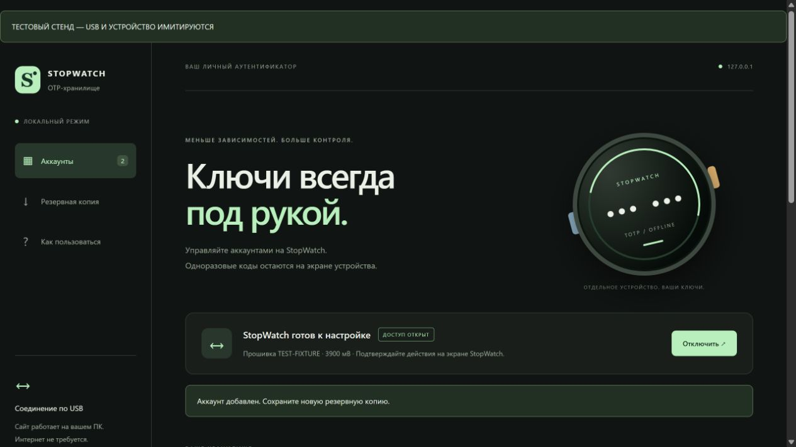

# Проверка версии 0.1.0

Дата: **18 октября 2026**, часовой пояс пользователя Asia/Irkutsk.

## Результаты

| Проверка | Результат |
|---|---|
| Сборка ESP-IDF 5.5.4, ESP32-S3, GCC 14.2.0 | Успешно; образы приложения, загрузчика и таблицы разделов подготовлены |
| Размер приложения | Около 1 МБ, помещается в раздел 7 МиБ; точный размер и SHA-256 — в `dist/firmware/manifest.json` |
| JavaScript, Node.js 24 | 12 тестов, все прошли |
| Python 3.12 | 16 тестов, все прошли |
| Native C++ с mbedTLS из ESP-IDF и Zig 0.14.1 | Все группы проверок прошли, `assert` принудительно включён (`-UNDEBUG` и compile-time guard) |
| Контроль конфигурации перед выдачей образов | Secure Boot, аппаратное шифрование, eFuse-программирование и дампы памяти исключены; консоль и аварийная печать отключены |
| Контроль готового комплекта | SHA-256 трёх образов проверяется до вызова esptool |

Native-тесты компилируют реальные `crypto.cpp`, `pattern.cpp`, `vault.cpp` и `protocol.cpp`; Flash, NVS, монотонные часы, UI-подтверждение и USB заменены тестовыми реализациями. Проверены:

- Все 18 векторов RFC 6238 для SHA1/SHA256/SHA512 и смена временного интервала.
- PBKDF2 с 600000 итераций и AES-256-GCM против независимо рассчитанных значений Node/OpenSSL; очистка результата при неправильном GCM-теге.
- Шифрование имён и секретов во Flash, неверный рисунок, смена графического ключа, 100 записей, удаление, явный сброс.
- Обрывы стирания, заголовка, данных и commit-маркера, выбор предыдущего снимка, повреждение обоих снимков.
- Восемь точек обрыва при смене рисунка и ещё восемь при переходе с PIN: сохранённые данные открываются ключом последнего подтверждённого снимка.
- Сохранение счётчика попыток до KDF, задержка после перезагрузки и закрытие доступа при ошибке NVS.
- Отказ в списке без разрешения, подтверждение экспорта, отмена, отсутствие секретов в метаданных.
- Полная замена набора только после получения всех записей и подтверждения; отмена и обрыв DTR сохраняют прежние данные.
- Очистка незавершённой передачи и частичного входного сообщения при блокировке.
- Учёт задержки подтверждения установки времени; переданное компьютером поле `receivedAt` не влияет на расчёт.
- Отказ в некорректном переименовании до вывода запроса подтверждения.
- Восстановление парсера после переполненного USB-кадра.

## Перенос из Google Authenticator

Проверено **18 октября 2026**, Asia/Irkutsk. Сайт принимает экспорт `otpauth-migration://` версии 1 через камеру, картинку или ссылку. Изменения не требуют новой прошивки.

- Пройдены 24 JavaScript-теста, включая 9 проверок миграции: параметры и публичный ключ RFC 6238, несколько QR в произвольном порядке, повтор QR, отрицательный batch ID, повреждённый protobuf, неподдерживаемые записи, выбор аккаунтов, предел 100 записей и очистка секретов. Три проверки камеры покрывают позднее разрешение после закрытия, остановку потока и ошибки доступа/воспроизведения.
- Пройдены 16 Python-тестов. Сервер разрешает камеру только своему источнику, сохраняет запрет микрофона, внешних соединений и загрузки данных через HTTP.
- В Edge через Playwright на явно обозначенном тестовом USB-стенде проверены сбор двух QR, запрет неполного экспорта, повтор QR, выбор одного из трёх аккаунтов, перенос оставшихся с пропуском существующего, распознавание PNG настоящей jsQR, камера с синтетическим видеопотоком и закрытие камеры при позднем разрешении.
- Отказ второго USB-сохранения останавливает перенос: первая запись остаётся, третья не отправляется, автоматического повтора нет. Проверены счётчик, сообщение об остановке и отсутствие ошибок JavaScript. Диалог просмотрен на снимке браузера.

Все ключи в этих проверках — публичные тестовые данные. Физическая камера, реальные QR пользователя и сохранение на физический StopWatch в этой проверке не использовались. После переноса требуется сравнить коды с телефоном при правильном времени устройства.

## Повторный ввод через 12 часов и экраны настройки

Проверка выполнена **18 октября 2026**, Asia/Irkutsk. Экран гаснет через 30 секунд без физических действий; хранилище остаётся разблокированным на 12 часов после успешного ввода, создания или смены ключа. USB-разрешение и ожидающие подтверждения закрываются при погашении экрана.

- Набор с реальными LVGL и `ui.cpp` проверяет границу 12 часов с точностью до миллисекунды, пробуждение касанием и кнопкой до истечения срока, истечение срока с погашенным экраном, ручную блокировку, перезапуск и переход через переполнение 32-битного счётчика миллисекунд. Активность и изменение достоверности RTC не продлевают доступ.
- Сетка увеличена с 260 × 250 до 340 × 320 пикселей; расстояние между точками — со 90 до 120 пикселей. Сброс вынесен на отдельный экран по синей кнопке; проверены переход назад, отмена сброса с сохранением аккаунтов и явное подтверждение удаления.
- Проверены все сочетания наличия аккаунтов и достоверности времени: кнопка USB дублируется в списке при отсутствии аккаунтов или времени, на экране кода — при отсутствии времени; в настройках доступна всегда. Проверены включение, закрытие и обновление подписи после отзыва USB-разрешения.
- Полный native-набор криптографии, хранилища, жестов и USB-протокола прошёл. Сборка ESP-IDF 5.5.4 для ESP32-S3 успешна; точный размер и контрольные суммы новых образов указаны в `dist/firmware/manifest.json`.
- По изображениям реального рендера LVGL с круглой маской проверены сетка, линии, подсказки, экран сброса и расположение кнопок USB.

На физическое устройство эта версия не записывалась. Сон без USB и длительный 12-часовой сценарий на аппаратуре описаны в [HARDWARE-TESTS.md](HARDWARE-TESTS.md).

## Ускорение проверки ключа

Проверка выполнена **18 октября 2026**, Asia/Irkutsk. PBKDF2-HMAC-SHA256 сохраняет 600000 итераций, 16-байтную соль и 32-байтный результат. Состояния SHA-256 после блоков HMAC ipad/opad вычисляются один раз на вызов, затем копируются через API mbedTLS. Это сокращает обработку примерно с 2,4 до 1,2 миллиона блоков SHA-256. Все промежуточные состояния стираются при выходе; кэш между разблокировками отсутствует. Форматы хранилища и ограничитель попыток не менялись.

- Native-набор прошёл полностью: независимые векторы Python hashlib/OpenSSL для PIN, пустой строки, четырёх и шести точек; сравнение с исходным mbedTLS для восьми длин входа, включая 63/64/65/128 байт, и разных двоичных солей.
- Исторический снимок с PIN теперь создаётся исходным PBKDF2 из mbedTLS, а открывается оптимизированной реализацией. Проверены миграция, смена рисунка, сбои записи, перезагрузка и ограничитель попыток.
- Набор с реальными LVGL и `ui.cpp` прошёл: создание, смена и подтверждение рисунка, разблокировка, задержки, пробуждение и переход со старого PIN.
- В одном сравнительном замере на ПК для входа длиной 25 байт: исходный mbedTLS **606,7 мс**, оптимизированный **324,8 мс** (примерно **1,87 раза**). Это измерение программного SHA на ПК, а не аппаратного SHA на ESP32-S3.
- Сборка ESP-IDF 5.5.4 для ESP32-S3 прошла с включённым аппаратным SHA, частотой 240 МГц и оптимизацией производительности; образ приложения занимает 1030192 байта.

Устройство не прошивалось; выигрыш на физическом StopWatch ещё не измерен. Сравнительный аппаратный сценарий добавлен в [HARDWARE-TESTS.md](HARDWARE-TESTS.md). Для сохранения аккаунтов используется обновление приложения через `tools/flash.py --update`, а не объединённый образ первой установки.

## Графический ключ и совместимость

Проверка выполнена **18 октября 2026**, Asia/Irkutsk. Графический ключ полностью заменяет PIN после обязательного перехода старого хранилища на формат 2.

- Проверены длины 3/4/5/6/7, повторные точки, порядок, автоматическое включение середины ряда/столбца/диагонали, быстрые и медленные жесты, переполнение и очистка ввода.
- Проверено, что шестая точка участвует в KDF: два рисунка с одинаковыми первыми пятью точками не взаимозаменяемы.
- Независимый генератор исторического снимка формата 1 подтверждает совместимость старого PIN. После перехода оба снимка имеют формат 2, аккаунты сохранены, старый PIN отклоняется.
- Проверены восемь границ записи при миграции, повторная загрузка и выбор правильного способа входа по последнему подтверждённому снимку.
- USB отклоняет список, экспорт и изменения до завершения миграции, даже при устаревшем флаге разрешения; статус остаётся `locked`.

Отдельный режим `tools/test-native.py --ui` компилирует **реальные LVGL 9.5.0 и `ui.cpp`** с имитацией платы и сенсора. Оба набора сценариев прошли:

- создание ключа и несовпадающее подтверждение; отмена и завершение смены ключа; разблокировка только после отпускания пальца, в том числе за пределами сетки;
- потеря касания, недопустимая длина без увеличения счётчика, пятая неверная попытка и блокировка ввода на время задержки;
- пробуждение боковой кнопкой и сигналом сенсора без разблокировки;
- ввод прежнего PIN, запрет перехода к аккаунтам боковыми кнопками до завершения миграции, отмена с возвратом к PIN, сохранение аккаунтов после подтверждения рисунка.

По изображениям из реального рендера LVGL проверены расположение девяти точек, подсветка, соединяющие линии, кириллица и нижняя кнопка. Успешно выполнены сборка ESP-IDF, проверки конфигурации и контрольных сумм образов, 12 JavaScript-тестов и 16 Python-тестов. ZIP-комплект обновлён.

**На физическом устройстве это изменение не проверялось; прошивка не выполнялась.** Реальные касания, форма круглого дисплея, пробуждение драйвером сенсора и аппаратные обрывы питания остаются в [HARDWARE-TESTS.md](HARDWARE-TESTS.md).

## Проверка сайта в браузере

Сайт открыт в Chromium-браузере Codex. Рабочая страница без устройства показывает закрытый доступ; действия с аккаунтами отключены. На отдельном адресе `127.0.0.1:8766` запущен явно помеченный тестовый USB-стенд с публичными фиктивными аккаунтами. Этот стенд не входит в рабочий сайт и не подключается к физическому USB.

Через интерфейс проверены подключение, список, импорт URI, распознавание QR-картинки локальной jsQR, автозаполнение SHA512/8 цифр/60 секунд, изменение названия после импорта, создание зашифрованного файла и двухэтапное восстановление с проверкой количества записей. Созданный браузером файл независимо расшифрован модулем Node.js: обе тестовые записи совпали, открытые секреты в файле отсутствуют.

HTTP-сервер проверен на запрет POST, выход за корень файлов, листинг каталогов и посторонний Host. Заголовки запрещают внешние соединения, iframe, формы и сторонние скрипты; все зависимости поставляются локально. Отдельное физическое отключение интернета на компьютере не выполнялось.

## Что требует реального устройства

При первоначальной сборке COM-порт не был подключён; агент образы на устройство не записывал. При последующей проверке Python-клиента обнаружен реальный **COM4**, успешно открыт USB CDC с DTR и прочитан статус: прошивка **0.1.0**, состояние `locked`, `authorized:false`, `timeValid:false`, `retryAfter:0`. Это подтверждает обмен протоколом с физическим устройством через pySerial 3.5, включая Windows-ярлык запуска. Импорт настоящего аккаунта и установка времени при этой проверке не выполнялись: они требуют действий владельца на экране StopWatch.

Для Python-клиента добавлено восемь автоматических проверок: URI/Base32 и ограничения, полная проверка файла до импорта, DTR и побайтный UTF-8, повтор только чтения при первом подключении, отсутствие повторного изменения при тайм-ауте, ограничение/проверка кадров и безопасные ошибки, ожидание физического разрешения без открытия нового порта, отказ от отображаемого ввода секретов. Все **16 Python-тестов** проекта проходят. Обновлённый ZIP содержит скрипт, зависимость и ярлык запуска.

Не проверены физические сенсор и экран, аппаратный CDC в Windows Chrome/Edge, сохранение RTC после выключения/разряда, сон, фактическая длительность PBKDF2 и расход аккумулятора. Эти проверки перечислены в [HARDWARE-TESTS.md](HARDWARE-TESTS.md); автономность до измерения не заявляется.

Сначала выполните полный аппаратный цикл на тестовом аккаунте: импорт → правильный код → копия → сброс → новый графический ключ → восстановление → правильный код. Это обязательный критерий готовности к повседневному использованию, который не заменяется программной симуляцией.
